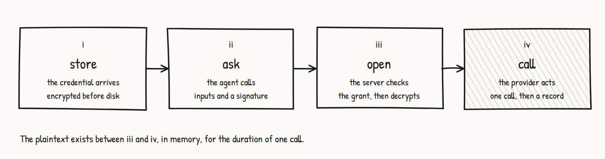
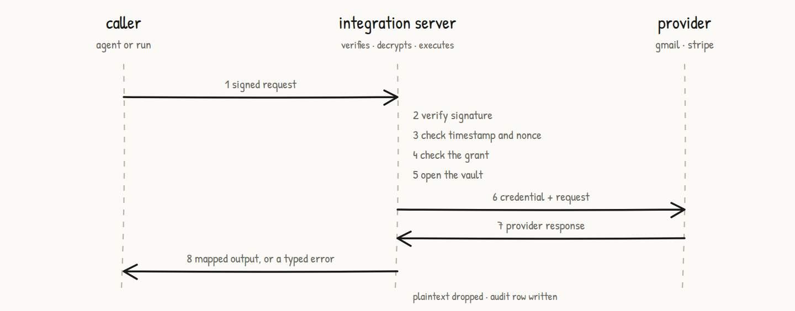

# MICP — Managed Integration & Credential Protocol

**Integrations for agents, without lending them the keys.**

Version 0.1 · 26 November 2026 · Elizeu Carlos · [CC BY 4.0](LICENSE)

Project page: **https://micpprotocol.com**

---

## Abstract

Software agents are now asked to act on real systems: send mail, publish video, write rows into a
spreadsheet. The usual way to grant that access is to hand the agent a credential (a token, a password, an
API key) and to hope that the transcript stays private. This paper describes MICP, a declarative protocol in
which an agent never holds a credential. Integrations declare what exists; accounts hold the secrets,
encrypted under a single vault key; grants decide, per account and per method, who may call what; and every
call is signed, scoped and recorded. We separate what a protocol must specify from what an implementation
may choose, and we argue that existing tool-calling protocols sit above this layer rather than replacing it.

**Keywords:** agent tooling, credential management, least privilege, declarative integration, audit

---

## Contents

1. [Introduction](#1-introduction)
2. [The model](#2-the-model)
3. [Keys](#3-keys)
4. [Calls](#4-calls)
5. [Discovery](#5-discovery)
6. [Implementation](#6-implementation)
7. [Conformance](#7-conformance)
8. [Status of this document](#8-status-of-this-document)
9. [Relationship to MCP and other transports](#9-relationship-to-mcp-and-other-transports)

---


*Figure 1. The whole protocol in one drawing: the agent asks, the client assembles the tools, the
integration server holds the accounts and performs the call, and the vault key stays behind, outside the
database and outside every conversation.*

Three roles appear in every deployment, and none of them is a product. The **agent** is the model that
chooses among tools and asks for an action. The **client** is the software that hosts the agent and
assembles the list of tools it is allowed to see. It may be a chat application, a workflow engine, an editor
or a command line. The **integration server** holds the accounts, the vault and the execution path. The
protocol constrains what is declared and how a call is authorised; it says nothing about who builds the
client or in what language.

---

## 1. Introduction

An agent needs to send an email. The shortest path is to paste an application password into the
conversation. It works, and for about three weeks nobody notices anything.

Then the account is used by someone else, or the password is rotated at the provider, or a support ticket is
filed with the transcript attached. The credential now exists in four places: the conversation, the model
provider's logs, the client's history, and whatever the user pasted it into. None of those places is the
place it should be.

The same scene repeats with a second problem behind the first. A credential is not a permission. An app
password issued to send mail is also a key to read every message in the mailbox, delete folders and change
the account's settings. Delegating "send this email" delegates considerably more than the sentence suggests.
And because the credential travels with the agent, there is no point at which a system can ask whether *this
particular action* was allowed.

Existing tool-calling protocols improve the picture by moving the credential out of the prompt and behind a
tool. That solves the first problem. The second remains: a tool is either visible to the model or it is not,
and the notion of who may call what lives in the client, if it exists at all. The third, a record of what
happened, becomes whatever the client chose to keep.

MICP is an attempt to specify the layer underneath. It assumes that the interesting unit is not the
integration but the *method on a specific account*, that credentials belong to a vault rather than to a
caller, and that permission is data, not a property of a key.

Section 2 gives the model. Section 3 describes the key hierarchy. Section 4 specifies a call. Section 5
covers discovery and why it must be filtered. Section 6 is an implementation guide for a client that exposes
these integrations to a model. Section 7 lists the conformance checks, Section 8 separates what is
implemented from what is intended, and Section 9 relates this layer to existing tool-calling standards.

---

## 2. The model

Three nouns, one relation each:

- An **integration** is a type, such as `gmail`, `stripe` or `telegram`. It declares the methods this service
  can perform and how a credential for it is obtained.
- An **account** is one credential attached to an integration: a mailbox, a store, a bot. Accounts are data,
  so adding the tenth Gmail account is one row, not a new integration.
- A **method** is one operation with a contract: an input schema, an output schema, a transport, and a
  declaration of the secret it needs.


*Figure 2. The three nouns. Twenty accounts sharing six methods produce six contracts, not a hundred and
twenty. And a method is enabled per account, so one mailbox may send while another may also read.*

A method is *declarative*: a transport, a request template, an input schema and an output map. It contains
no code. The executor is written once and interprets the declaration, which is why adding an integration is
a configuration change rather than a deployment, and why a pack can be reviewed by reading it.

```json
{ "integration": "gmail",
  "accounts": [
    { "account": "elizeu",  "enabled_methods": ["send"] },
    { "account": "support", "enabled_methods": ["send", "read", "mark_read"] }
  ],
  "methods": {
    "send": { "transport": "smtp",
              "fields": { "account": "account", "to": "email", "subject": "text", "body": "text" },
              "secrets": { "password": "$vault:app_password" },
              "output": { "sent": "boolean", "id": "text" } }
  } }
```

Two consequences follow, and they carry most of the argument. First, the account is a *parameter* of the
method, never a free-form string: the caller chooses from a list, so the model cannot invent a mailbox.
Second, the secret is a *reference*, never a value: the pack is shareable, reviewable and safe to store in a
repository.

---

## 3. Keys

There are two kinds of key in MICP, and they answer different questions. Provider credentials belong to the
services and are numerous. The vault key belongs to the installation and is singular.

**Table 1. Keys in a MICP deployment.**

| Key | Count | Function | Leaves the server |
|---|---|---|---|
| Vault key | one per installation | encrypts and decrypts stored credentials | never |
| Account credential | one per account | what the provider issued | only on the outbound call |
| Access token | one per agent or run | who may call which method | to that caller |

The vault key is the only secret an operator has to keep, rotate and back up. It authenticates nothing and
authorises nothing: it opens a store. Permission is decided elsewhere, in the grant table, because a key that
decides policy is a key that must be edited to change policy, and that is how permissions end up spread
across files.


*Figure 3. The vault key lives outside the database. A stolen dump contains ciphertext, account names and
grant rows, and no usable secret.*

### 3.1 Storage and retrieval

A credential is encrypted before it touches disk, with a random nonce per record and the record's address
bound into the authenticated data: workspace, integration, account, field. Copying a row into another
account therefore fails to decrypt, which turns a database write into a non-event.



*Figure 4. The plaintext exists between iii and iv, in memory, for the duration of one call.*

Rotation replaces the vault key without re-asking anyone for anything: a new key is generated alongside the
old, new writes use it, a background pass re-encrypts the remaining rows, and the old key is retired when no
row refers to it. Rotation bounds the damage of a key copied without the operator's knowledge; it does not
stop an attack in progress, which is a matter for revocation.

---

## 4. Calls

A call carries a method, an account, the inputs, and a signature over the exact bytes. Two questions are
answered by two different mechanisms, and conflating them produces systems with authentication and no
authorisation.

The *signature* answers whether the request is authentic and unmodified. It covers the body together with a
timestamp and a nonce, so a replay is both detectable and useless. The *grant* answers whether this caller
may perform this method on this account. A valid signature from a caller without a grant is a well-formed
refusal.

```http
POST /methods/gmail.send
Authorization: Bearer <run pass>                 # who is calling, scoped, 15 minutes
X-Micp-Run:    r_8f21
X-Micp-Ts:     1795649100
X-Micp-Nonce:  7c1a9f

{"account":"support","to":"joao@example.com","subject":"Report","body":"Attached."}
```



*Figure 5. The caller sees steps 1 and 8. Steps 2 to 7 happen behind the counter, and only step 6 leaves the
server, carrying the provider credential, never the vault key.*

Errors are typed rather than free text: invalid input, vault unavailable, not authorised, provider failure,
idempotency conflict. A caller can therefore react deterministically, and an operator can count failures by
kind. Idempotency is per run, node and attempt, so a retry after a crash does not send the same email twice.

---

## 5. Discovery

A server that exports what it has is a server that exports too much. Discovery in MICP is filtered by the
same grants that authorise calls, and the filtering happens on the server, before the caller sees anything.

A method the caller cannot use is not refused at execution time; it does not appear. The difference is not
cosmetic. Rejection tells an agent that something exists and invites a retry with a different argument;
invisibility leaves nothing to attempt. It also keeps prompts small, which is the practical reason many
deployments end up doing this anyway.


*Figure 6. Two filters in series. Neither happens in the model, and neither requires the caller to be
trusted.*

Because the announcement contains no secrets (names, descriptions, schemas), it can be served freely, cached
and shown in a user interface. It is a menu, not a key.

---

## 6. Implementation

A model does not require a protocol in order to receive tools. It requires a name, a description and a JSON
schema. Whoever assembles that list is the client, and that assembly is the work this section specifies.

1. **Place the vault.** In the same process, or on a separate integration server. If separate, the client
   records a URL and the two sides pair once with a short-lived code that carries the workspace scope.
2. **Expose discovery.** The server answers what exists for that workspace: accounts, methods, input and
   output schemas, filtered as in Section 5.
3. **Cross with grants.** Keep only what this agent may call. This happens before the model is prompted, not
   after it tries.
4. **Translate into tools.** One tool per account and method, with a stable name, a natural-language
   description and the fields as a schema. The account is folded into the name so that it cannot be invented.
5. **Forward signed calls.** When the model selects a tool, forward the inputs with a signature, verify the
   result and return the mapped output.

Announcing everything is simpler to implement and easier for a model to use, at a measurable cost: each
schema occupies context on every call. The trade-off is a product decision, not a protocol one, and it is
reversible per workspace, which is the reason enablement is a property of the workspace rather than of the
installation.

---

## 7. Conformance

An implementation conforms to MICP v0.1 if it satisfies the following. The list is deliberately short: every
item can be checked by reading a pack or by issuing a request.

1. A method is one operation, with an input and an output schema.
2. Every method names a transport from `{http, smtp, imap}`.
3. Secrets are referenced, never embedded: `$vault:name.field`.
4. No pack contains a credential, in any form, including examples.
5. Every integration declares an allowlist of destinations.
6. Grants are per account and per method, never per integration.
7. Discovery returns only what the caller is granted.
8. Every call is idempotent per run, node and attempt.
9. Calls carry a timestamp and a nonce; replays are rejected.
10. Errors are typed, and the type is stable across versions.
11. The vault key is stored outside the database, with a separate backup and a tested restore.
12. Every call is recorded: account, method, caller, run, outcome, duration.

---

## 8. Status of this document

This document describes a protocol that is partly implemented. The distinction matters, so it is stated
rather than implied.

**Table 2. Implemented and intended, as of v0.1.**

| Element | State | Note |
|---|---|---|
| Declarative methods | implemented | transports http, smtp, imap |
| Accounts as data | implemented | methods enabled per account |
| Grants per method | implemented | enforced before execution |
| Filtered discovery | implemented | invisible, not refused |
| Audit of calls | implemented | account, method, caller, outcome |
| Vault with key rotation | in progress | single-key encryption shipped; versioned rotation next |
| Pairing with workspace scope | in progress | embedded mode complete; remote handshake next |
| Signed calls with nonce | in progress | scoped run passes shipped; body signature next |
| MCP and REST adapters | intended | adapters only; not part of the protocol |

---

## 9. Relationship to MCP and other transports

The choice is usually presented as a binary: hand the agent a credential, or put a tool-calling server in
front of the service. We argue that these are not alternatives. They answer different questions, and a
serious deployment ends up needing both answers.

**Table 3. Two layers, two questions.**

| Question | Answered by a tool-calling protocol | Answered by MICP |
|---|---|---|
| How does a tool reach the model? | yes, this is its whole subject | not its subject |
| Who holds the provider credential? | left to each server | the vault, outside the client |
| May this agent call this method on this account? | per server, at most | per account and per method |
| What happened, and with whose key? | whatever the client keeps | a record written by the server |
| What happens when a key is rotated? | not addressed | re-encryption, no re-entry |
| What if the same call is retried after a crash? | not addressed | idempotent per run and attempt |

A tool-calling protocol standardises the *transport of intent*: discovery, schemas, invocation, streaming. It
deliberately says nothing about credential custody, because custody is a property of the deployment, not of
the wire. The consequence is visible in practice: every server implementation decides for itself where the
API key lives, usually in its own configuration file, with the full authority of the account it represents,
and with logs that the client may or may not keep.

MICP occupies the other axis. It is transport-agnostic by construction, since the three transports it permits
are already the ones providers use. What it standardises is *authority*: which accounts exist, which methods
each account offers, who may call which of them, where the secret is stored, and what record remains.

### 9.1 Why one does not replace the other

Replacing a tool-calling protocol with MICP would mean rebuilding the parts it already does well: the client
ecosystem, the transport negotiation, resources and prompts, and the existing servers that speak it.
Replacing MICP with a tool-calling protocol would mean leaving three questions unanswered, and the answers
would have to be reinvented per deployment, differently each time.

The two compose in either direction, and both directions are in use:

- **MCP as an adapter over MICP.** A small server exposes the methods a caller is granted as tools. The
  client speaks MCP; the credentials never enter the MCP server's configuration, because it holds none: it
  forwards to the integration server, which does.
- **MICP as the substrate for adapters.** REST, OpenAPI, a command line or a message queue consume the same
  declarations. The integration server does not know which of them called.


*Figure 7. The adapter pattern. The MCP server is stateless with respect to credentials: it translates a tool
call into a signed request, and the integration server decides whether it may proceed.*

### 9.2 When a tool-calling protocol alone is enough

If there is one account, one agent, one operator, and no audit obligation, a tool-calling server with a key
in its configuration is a reasonable engineering decision. The protocol in this paper earns its place at the
point where a second account appears, or a second agent, or a third party who asks who used the key. That is
also the point at which the ad-hoc answer stops being auditable, and the cost of retrofitting it is paid in
incidents rather than in code.

> **The claim, in one sentence.** A tool-calling protocol moves the credential out of the prompt; MICP moves
> it out of the caller, and puts a decision and a record in between. The first is necessary. The second is
> what makes the first safe to operate.

---

## How to cite

> Carlos, E. (2026). *MICP: Managed Integration & Credential Protocol* (Version 0.1). Zenodo.
> https://doi.org/10.5281/zenodo.XXXXXXX

A `CITATION.cff` file is included, so GitHub shows a "Cite this repository" button.

## Revision history

| Version | Date | Changes |
|---|---|---|
| 0.1 | 26 Nov 2026 | First public draft: nine sections, seven figures, twelve conformance checks. |

## License

The specification text and figures in this repository are licensed under
[Creative Commons Attribution 4.0 International](LICENSE) (CC BY 4.0).

You may quote, reproduce and implement this specification, provided you attribute it. Implementations may
carry a different license of their own; the one above covers this document, not software that follows it.
