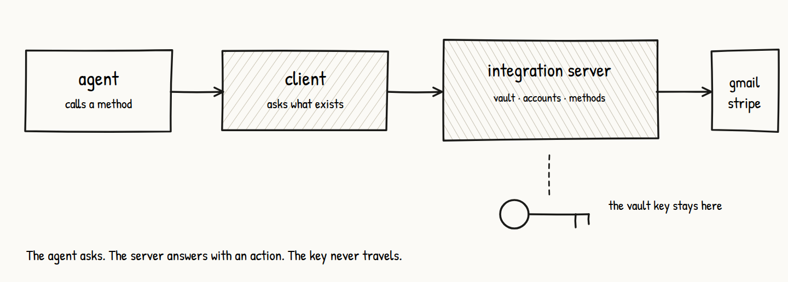
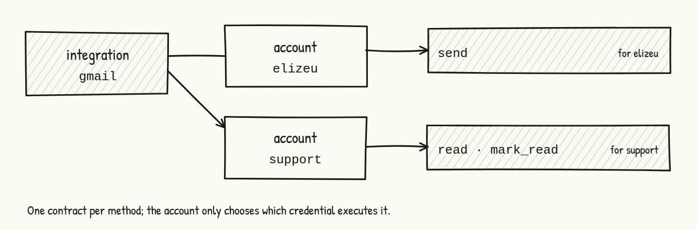
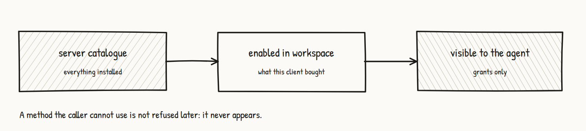
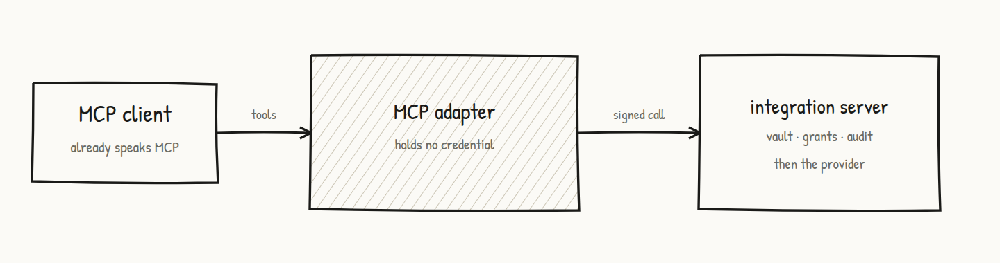

# MICP: Managed Integration & Credential Protocol

**Integrations for agents, without lending them the keys.**

Version 0.2 · 26 November 2026 · Elizeu Carlos · All rights reserved

Project page: **https://micpprotocol.com**
Build an integration in the browser: **https://micpprotocol.com/builder.html**

---

## Abstract

Software agents are now asked to act on real systems: send mail, publish video, write rows into a
spreadsheet. The usual way to grant that access is to hand the agent a credential (a token, a password, an
API key) and to hope that the transcript stays private. This paper describes MICP, a declarative protocol in
which an agent never holds a credential. Integrations declare what exists; accounts hold the secrets,
encrypted under a single vault key; grants decide, per account and per method, who may call what; and every
call is signed, scoped and recorded. We separate what a protocol must specify from what an implementation
may choose, and we argue that existing tool-calling protocols sit above this layer rather than replacing it.

**Keywords:** agent tooling, credential management, least privilege, declarative integration, audit

---

## Contents

1. [Introduction](#1-introduction)
2. [The model](#2-the-model)
3. [Keys](#3-keys)
4. [Calls](#4-calls)
5. [Discovery](#5-discovery)
6. [Implementation](#6-implementation)
7. [Conformance](#7-conformance)
8. [Status of this document](#8-status-of-this-document)
9. [Relationship to MCP and other transports](#9-relationship-to-mcp-and-other-transports)

---



*Figure 1. The whole protocol in one drawing: the agent asks, the client assembles the tools, the
integration server holds the accounts and performs the call, and the vault key stays behind, outside the
database and outside every conversation.*

Three roles appear in every deployment, and none of them is a product. The **agent** is the model that
chooses among tools and asks for an action. The **client** is the software that hosts the agent and
assembles the list of tools it is allowed to see. It may be a chat application, a workflow engine, an editor
or a command line. The **integration server** holds the accounts, the vault and the execution path. The
protocol constrains what is declared and how a call is authorised; it says nothing about who builds the
client or in what language.

---

## 1. Introduction

An agent needs to send an email. The easy way is to paste an application password into the chat. It works.
For about three weeks, nobody notices anything.

Then the account is used by someone else. Or the password is changed at the provider. Or a support ticket
arrives with the whole conversation attached. The password now lives in four places: the chat, the
provider's logs, the client's history, and whatever the user pasted it into. None of them is where it should
be.

There is a second problem behind the first. A password is not a permission. A mail password that lets you
send is also a key to read every message, delete folders and change settings. Saying *send this email* hands
over much more than the sentence says. And because the password travels with the agent, nothing can check
whether this one action was allowed.

Tool-calling protocols made this better. They move the password out of the chat and behind a tool. That fixes
the first problem. The second stays: a tool is either visible to the model or it is not, and *who may call
what* lives in the client, if it lives anywhere. The record of what happened is whatever the client chose to
keep.

MICP describes the layer below. The unit that matters is not the integration but the *method on a specific
account*. Passwords belong to a vault, not to a caller. Permission is data, not a property of a key.

Section 2 gives the model. Section 3 covers keys. Section 4 shows a call. Section 5 explains discovery.
Section 6 describes how to build a client. Section 7 lists the conformance checks. Section 8 separates what
is implemented from what is planned. Section 9 relates this layer to other tool-calling standards.

---

## 2. The model

Three nouns, and one rule for each:

- An **integration** is a type, such as `gmail`, `stripe` or `telegram`. It declares the methods this service
  can perform and how a credential for it is obtained.
- An **account** is one credential attached to an integration: a mailbox, a store, a bot. Accounts are data,
  so adding the tenth Gmail account is one row, not a new integration.
- A **method** is one operation with a contract: an input schema, an output schema, a transport, and a
  declaration of the secret it needs.



*Figure 2. The three nouns. Twenty accounts sharing six methods produce six contracts, not a hundred and
twenty. And a method is enabled per account, so one mailbox may send while another may also read.*

A method is *declarative*: an endpoint, a request template, an input schema and an output map. It contains no
code. The executor is written once and reads the declaration, which is why adding an integration is a
configuration change and not a deployment, and why a pack can be reviewed by reading it.

```json
{
  "micp": "0.2",
  "integration": "email",
  "description": "Send email from a mailbox.",

  "defaults": {
    "smtp_host": "smtp.gmail.com",
    "smtp_port": 465,
    "tls": "implicit"
  },

  "accounts": [
    { "account": "elizeu",
      "config":  { "email": "elizeu@exemplo.pt" },
      "custom":  { "assinatura": "Elizeu Carlos" },
      "secrets": { "app_password": "{{vault:email.elizeu.app_password}}" } },

    { "account": "suporte",
      "config":  { "email": "suporte@exemplo.pt", "smtp_port": 587, "tls": "starttls" },
      "custom":  { "assinatura": "Equipa de suporte" },
      "secrets": { "app_password": "{{vault:email.suporte.app_password}}" } }
  ],

  "methods": {
    "send": {
      "description": "Send an email from the selected account.",
      "transport": "smtp",

      "endpoint": {
        "host": "{{defaults.smtp_host}}",
        "port": "{{account.smtp_port | default:defaults.smtp_port}}",
        "tls":  "{{account.tls       | default:defaults.tls}}"
      },

      "request": {
        "auth":    { "user": "{{account.email}}", "password": "{{secret.app_password}}" },
        "from":    "{{account.email}}",
        "to":      "{{input.to}}",
        "subject": "{{input.subject}}",
        "body":    "{{input.body}}\n\n{{account.custom.assinatura}}"
      },

      "fields": {
        "to":      { "type": "email", "required": true },
        "subject": { "type": "text",  "required": true, "max": 200 },
        "body":    { "type": "text",  "required": true }
      },

      "output": { "sent": "constant:true", "message_id": "smtp.message_id" }
    }
  },

  "destinations": ["{{defaults.smtp_host}}"]
}
```

Configuration lives at three levels, and the method is written once for all of them. That is what makes a
second account a row of data instead of a second integration.

**Table 2. Where a value comes from.**

| In the template | Source | Visible to |
|---|---|---|
| `{{defaults.x}}` | the integration defaults, shared by every account | everyone |
| `{{account.x}}` | a field of the account, in `config` | discovery, UI, logs |
| `{{account.custom.x}}` | a user-defined extra, in `custom` | discovery, UI, logs |
| `{{secret.x}}` | the vault, decrypted for the duration of the call | nobody |
| `{{input.x}}` | a field declared in `fields` and sent by the caller | the caller |

The rule for placing a value is one question: *if this appeared in a screenshot or in the discovery response,
would it grant access?* If yes, it belongs in the vault. If no, it belongs to the account. Nothing else
decides.

Two consequences follow. First, the account is a *parameter* of the method, never a free string: the caller
picks from a list, so a model cannot invent a mailbox. Second, a secret is a *reference*, never a value: the
pack can be shared, reviewed and kept in a repository.

---

## 3. Keys

MICP has two kinds of key, and they answer different questions. Provider keys belong to the services, and
there are many. The vault key belongs to the installation, and there is one.

**Table 1. Keys in a MICP deployment.**

| Key | Count | Function | Leaves the server |
|---|---|---|---|
| Vault key | one per installation | encrypts and decrypts stored credentials | never |
| Account credential | one per account | what the provider issued | only on the outbound call |
| Access token | one per agent or run | who may call which method | to that caller |

The vault key is the only secret an operator has to keep, rotate and back up. It does not authenticate
anyone and it does not grant anything: it opens a store. Permission is decided in the grant table, because a
key that decides policy has to be edited to change policy, and that is how permissions end up spread across
files. It is a plain pair of keys: one private key that decrypts, one public key that encrypts. Two files,
two lines of configuration, no special format.


*Figure 3. The vault key lives outside the database. A stolen dump contains ciphertext, account names and
grant rows, and no usable secret.*

### 3.1 Storage and retrieval

A credential is encrypted before it touches disk, with a random nonce per record and the record's address
bound into the authenticated data: workspace, integration, account, field. Copying a row into another
account therefore fails to decrypt, which turns a database write into a non-event.


*Figure 4. The plaintext exists between iii and iv, in memory, for the duration of one call.*

Rotation replaces the vault key without asking anyone for anything: a new key is generated alongside the
old, new writes use it, a background pass re-encrypts the remaining rows, and the old key is retired when no
row refers to it. Rotation bounds the damage of a key copied without the operator's knowledge; it does not
stop an attack in progress, which is a matter for revocation.

---

## 4. Calls

A call carries a method, an account, the inputs, and a signature over the exact bytes. Two questions get two
different answers, and mixing them produces systems that authenticate and never authorise.

The *signature* says whether the request is genuine and unchanged. It covers the body, a timestamp and a
nonce, so a replay is visible and useless. The *grant* says whether this caller may run this method on this
account. A good signature from a caller without a grant is a well-formed refusal.

```http
POST /v1/call/email.elizeu.send
Authorization: Bearer <access token>       # who is calling, and only that
Content-Type: application/json

{ "input": { "to": "joao@exemplo.pt",
             "subject": "Relatório",
             "body": "Segue em anexo." } }
```


*Figure 5. The caller sees steps 1 and 8. Steps 2 to 7 happen behind the counter, and only step 6 leaves the
server, carrying the provider credential, never the vault key.*

Errors are typed rather than free text: invalid input, vault unavailable, not authorised, provider failure,
idempotency conflict. A caller can therefore react deterministically, and an operator can count failures by
kind. Idempotency is keyed by the caller's request identifier and attempt, so a retry after a crash does not
send the same email twice.

### 4.1 Three calls, end to end

The call carries the method in its name. Three groups, always in this order:
`integration.account.method`. The body carries only the inputs.


*Figure 6. Two hops, never more. The caller speaks HTTP to the integration server; the server speaks the
provider's own transport. Between them sit the grant, the vault and the rendered template, and the key never
comes back up the wire.*

```http
POST /v1/call/email.elizeu.send
Content-Type: application/json

{ "input": { "to": "joao@exemplo.pt",
             "subject": "Relatório",
             "body": "Segue em anexo." } }
```

What the integration server does with it, with the secret masked:

```
defaults.smtp_host            smtp.gmail.com
account.smtp_port             465        (from defaults, no override)
account.email                 elizeu@exemplo.pt
account.custom.assinatura     Elizeu Carlos
secret.app_password           ***

CONNECT smtp.gmail.com:465  implicit TLS
AUTH  elizeu@exemplo.pt  ***
MAIL FROM: elizeu@exemplo.pt
RCPT TO:   joao@exemplo.pt
DATA
  Subject: Relatório

  Segue em anexo.

  Elizeu Carlos
```

The same method, called on the other account, produces a different request with no change to the pack: the
second account overrides `smtp_port` and `tls`, and brings its own signature and its own secret.

```http
POST /v1/call/email.suporte.send
{ "input": { "to": "cliente@exemplo.pt", "subject": "Bilhete #4821", "body": "Em análise." } }

CONNECT smtp.gmail.com:587  STARTTLS      <-- override da conta
AUTH  suporte@exemplo.pt  ***
```

A third call, on a service that uses an HTTP API and a custom field, shows the same shape applied elsewhere.
Here the pack reads a destination from `defaults`, a channel from the account, a tone from the user-defined
extras, a token from the vault, and three fields from the caller.

```http
POST /v1/call/telegram.canal_curso.send
{ "input": { "text": "Episódio 12 no ar", "silent": false } }

-> POST https://api.telegram.org/bot***/sendMessage
  { "chat_id": "-100123456",                 <- {{account.chat_id}}
    "text": "Episódio 12 no ar",             <- {{input.text}}
    "parse_mode": "Markdown",                <- {{account.custom.formato}}
    "disable_notification": false }          <- {{input.silent}}
```

Nothing in these three calls required a line of code per integration. What changed between them was data: an
override here, a custom field there, a different transport in the third.

### 4.2 What comes back

Describing the response is optional. If a method has no `output`, the provider's answer comes back as it
arrived. That is the default, and it is what you want while you are building the integration.

If the method declares `output`, only the listed fields come back, each with a type:

```json
"output": {
  "message_id": { "path": "body.id", "type": "text", "required": true },
  "accepted":   { "path": "smtp.accepted", "type": "list" }
}
```

`output` chooses and checks. It does not transform: no renaming, no date arithmetic, no joins. If you need
that, do it where you call, not inside the pack.

One exception is worth spelling out. A few services return a *new* credential in the response, a refresh
token being the usual case. If the answer carries a field whose name matches a secret already stored for that
account, the server stores it in the vault, encrypted, and returns `{"stored": true}` in its place. The value
never leaves the server. Most integrations never do this, and for them it costs nothing. Large responses are
cut at 64 KB.

---

## 5. Discovery

A server that exports everything exports too much. Discovery uses the same grants as calls, and the filtering
happens on the server, before the caller sees anything.

A method the caller cannot use is not refused later. It never appears. The difference is not cosmetic. A
refusal tells the agent that something exists and invites a second attempt; invisibility leaves nothing to
try. It also keeps prompts small, which is why most deployments end up doing this anyway.



*Figure 7. Two filters in series. Neither happens in the model, and neither requires the caller to be
trusted.*

Because the announcement contains no secrets (names, descriptions, schemas), it can be served freely, cached
and shown in a user interface. It is a menu, not a key.

---

## 6. Implementation

A model does not need a protocol to get tools. It needs a name, a description and a JSON schema. Whoever
builds that list is the client, and building it is the work this section describes.

1. **Place the vault.** In the same process, or on a separate integration server. If separate, the client
   records a URL and the two sides pair once with a short-lived code that carries the workspace scope.
2. **Expose discovery.** The server answers what exists for that workspace: accounts, methods, input and
   output schemas, filtered as in Section 5.
3. **Cross with grants.** Keep only what this agent may call. This happens before the model is prompted, not
   after it tries.
4. **Translate into tools.** One tool per account and method, with a stable name, a natural-language
   description and the fields as a schema. The account is folded into the name so that it cannot be invented.
5. **Forward calls.** When the model selects a tool, send
   `POST /v1/call/{integration}.{account}.{method}` with the inputs, verify the result and return the mapped
   output.
6. **Install the pack.** An integration is one file on the server. Drop `packs/<integration>.micp.json` and
   reload: nothing else to build, nothing to deploy.

Announcing everything is simpler to build and easier for a model to use. It also costs context on every call.
That is a product decision, not a protocol one, and it can be changed per workspace, which is why enablement
belongs to the workspace and not to the installation.

### 6.1 Building an integration

An integration is a file, not a program. The pack says what the methods are; the server reads it and does the
work. There is no build step, no package to install and no code to review line by line: you read the file,
and you know what the integration can do.

To make that concrete, there is a builder at
[micpprotocol.com/builder.html](https://micpprotocol.com/builder.html). Four steps: the integration and its
defaults, the accounts, the methods, and the JSON. It shows the request that will be sent, with the secret
masked, and gives you the file to drop on your server.

What it will not do is the interesting part. There are no conditions, no loops, no expressions and no code
inside a pack. If a service needs logic to be called, it needs a new transport or it waits. A refusal is
easier to audit than a language.

---

## 7. Conformance

An implementation conforms to MICP v0.2 if it satisfies the following. The list is deliberately short: every
item can be checked by reading a pack or by issuing a request.

1. A method is one operation, with an input and an output schema.
2. Every method names a transport from `{http, smtp, imap}`.
3. Secrets are referenced, never embedded: `$vault:name.field`.
4. No pack contains a credential, in any form, including examples.
5. Every integration declares an allowlist of destinations.
6. Grants are per account and per method, never per integration.
7. Discovery returns only what the caller is granted.
8. Every call is idempotent per run, node and attempt.
9. Calls carry a timestamp and a nonce; replays are rejected.
10. Errors are typed, and the type is stable across versions.
11. The vault key is stored outside the database, with a separate backup and a tested restore.
12. Every call is recorded: account, method, caller, run, outcome, duration.

---

## 8. Status of this document

This document describes a protocol that is partly implemented. The difference matters, so it is stated rather
than implied.

**Table 3. Implemented and intended, as of v0.2.**

| Element | State | Note |
|---|---|---|
| Declarative methods | implemented | transports http, smtp, imap |
| Accounts as data | implemented | methods enabled per account |
| Grants per method | implemented | enforced before execution |
| Filtered discovery | implemented | invisible, not refused |
| Audit of calls | implemented | account, method, caller, outcome |
| Vault with key rotation | in progress | single-key encryption shipped; versioned rotation next |
| Pairing with workspace scope | in progress | embedded mode complete; remote handshake next |
| Signed calls with nonce | in progress | scoped run passes shipped; body signature next |
| MCP and REST adapters | intended | adapters only; not part of the protocol |

The protocol is specified carefully because the failure is expensive: a password handed to an agent cannot be
taken back. A feature written down but not built is a promise; a feature built but not written down is a
rumour. The table keeps both visible.

---

## 9. Relationship to MCP and other transports

The choice is usually put as a binary: give the agent a password, or put a tool-calling server in front of
the service. They are not alternatives. They answer different questions, and a real deployment needs both.

**Table 4. Two layers, two questions.**

| Question | Answered by a tool-calling protocol | Answered by MICP |
|---|---|---|
| How does a tool reach the model? | yes, this is its whole subject | not its subject |
| Who holds the provider credential? | left to each server | the vault, outside the client |
| May this agent call this method on this account? | per server, at most | per account and per method |
| What happened, and with whose key? | whatever the client keeps | a record written by the server |
| What happens when a key is rotated? | not addressed | re-encryption, no re-entry |
| What if the same call is retried after a crash? | not addressed | idempotent per run and attempt |

A tool-calling protocol standardises how intent travels: discovery, schemas, invocation, streaming. It says
nothing about who holds the password, on purpose, because that depends on the deployment and not on the wire.
In practice every server decides for itself, usually by putting the API key in its own configuration file,
with the full power of the account, and with logs the client may or may not keep.

MICP takes the other axis. It does not care how the call travels: the three transports it allows are the ones
providers already use. What it standardises is *authority*: which accounts exist, which methods each one
offers, who may call which, where the secret lives, and what record remains.

### 9.1 Why one does not replace the other

Replacing a tool-calling protocol with MICP would mean rebuilding what it already does well. Replacing MICP
with one would leave three questions open, and every deployment would answer them differently. The two fit
together, and both directions are in use:

- **MCP as an adapter over MICP.** A small server exposes the methods a caller is granted as tools. The
  client speaks MCP; the credentials never enter the MCP server's configuration, because it holds none: it
  forwards to the integration server, which does.
- **MICP as the substrate for adapters.** REST, OpenAPI, a command line or a message queue consume the same
  declarations. The integration server does not know which of them called.



*Figure 8. The adapter pattern. The MCP server is stateless with respect to credentials: it translates a tool
call into a signed request, and the integration server decides whether it may proceed.*

### 9.2 When a tool-calling protocol alone is enough

If there is one account, one agent, one operator, and no audit obligation, a tool-calling server with a key
in its configuration is a reasonable engineering decision. The protocol in this paper earns its place at the
point where a second account appears, or a second agent, or a third party who asks who used the key. That is
also the point at which the ad-hoc answer stops being auditable, and the cost of retrofitting it is paid in
incidents rather than in code.

> **The claim, in one sentence.** A tool-calling protocol moves the credential out of the prompt; MICP moves
> it out of the caller, and puts a decision and a record in between. The first is necessary. The second is
> what makes the first safe to operate.

---

## How to cite

> Carlos, E. (2026). *MICP: Managed Integration & Credential Protocol* (Version 0.2). Zenodo.
> https://doi.org/10.5281/zenodo.XXXXXXX

Version 0.2 is the current draft. A `CITATION.cff` file is included, so GitHub shows a "Cite this repository"
button.

## Revision history

| Version | Date | Changes |
|---|---|---|
| 0.1 | 26 Nov 2026 | First public draft: nine sections, seven figures, twelve conformance checks. |
| 0.2 | 26 Nov 2026 | Methods declare `endpoint` and a `request` template. Three levels of configuration (`defaults`, `account`, vault) and five template namespaces. Calls use `integration.account.method`. Optional `output`. Added 4.1 (three end-to-end examples), 4.2 (responses), 6.1 (building), and the browser builder. |

## License and terms of use

**Copyright (c) 2026 Elizeu Carlos. All rights reserved.**

This specification, its text, figures and diagrams may not be reproduced, distributed, published, modified,
translated or adapted, in whole or in substantial part, without prior written permission. Brief quotation (up
to 150 words) for review, commentary or academic citation is permitted, provided the author and source are
identified and a link to https://micpprotocol.com is included. See [LICENSE](LICENSE) for the full notice.

Quoting this document in an article, a paper or a review is welcome. Republishing it, redistributing it, or
building a derived specification from it is not.

Independent implementations of the protocol require a separate licence: hello@micpprotocol.com
